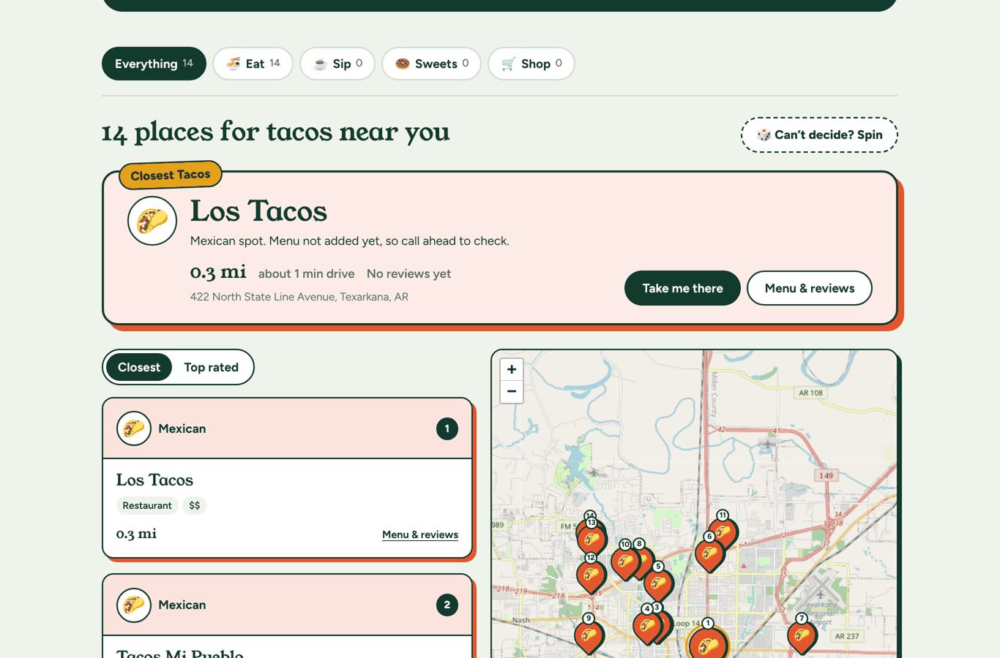

# 🍲 Food Hunt

**What are you craving? Type it, and Food Hunt shows the closest local place in Texarkana that makes it, on a map, with directions.**

[](https://github.com/kushalneupane-debug/food-hunt/actions/workflows/ci.yml)

**Live demo:** http://3.136.170.216/ &nbsp;·&nbsp; **Project board:** [GitHub Projects](https://github.com/users/kushalneupane-debug/projects/1)

CS 495 Capstone · Texas A&M University-Texarkana · Team **The Creators**



## Why we built it

Big review apps put chains first. The family-run taquería, the donut shop on New Boston Road or the
café downtown are hard to find unless you already know them. Food Hunt starts from what you want to eat,
not from a restaurant name, and lists only **local places: no chains and no gas stations**. That helps
small Texarkana food businesses get found.

## Features

| | |
|---|---|
| 🌮 **Craving search** | Type "tacos" and get the nearest places that serve them, closest first. Typos ("tocos") and related words ("boba" also finds milk tea) are handled. |
| 🗺️ **Map + directions** | Numbered pins match the list. The closest place is highlighted, and **Take me there** opens Google Maps directions. |
| 🏆 **Closest vs. best** | A spotlight card shows the nearest match and points out a better-rated place if one is a short drive away. Sort by **Closest** or **Top rated**. |
| 🍜☕🍩🛒 **Categories** | Eat, Sip, Sweets and Shop tabs, with cuisine and type filters inside each. |
| 📍 **Real places** | 67 local Texarkana places imported from OpenStreetMap ([how it works](docs/real-places.md)). |
| ⭐ **Reviews** | Rate authenticity, taste and value, and say what to order. |
| 🔐 **Accounts** | Sign up with email or phone, verified by a one-time code (JWT sessions). |
| 🎲 **Can't decide?** | Spin to let Food Hunt pick a place for you. |

## Tech stack

| Layer | Tools |
|---|---|
| Frontend | React 19, Vite, Leaflet + OpenStreetMap tiles |
| Backend | Node.js, Express, Zod validation, JWT, bcrypt, Helmet, rate limiting |
| Database | MySQL 8.4 with spatial queries (`ST_Distance_Sphere`) |
| Email / SMS | Nodemailer (SMTP), Twilio Verify |
| Testing | Jest + Supertest: 100 unit tests, 11 integration tests against real MySQL |
| DevOps | Docker Compose, AWS EC2 (Elastic IP), GitHub Actions CI, GitGuardian |

## How it works

```
Browser (React) ──/api──▶ Express API ──SQL──▶ MySQL 8.4
                             │                    ▲
        "tocos" → tacos      │                    │ real places
        + taco, birria,      │                    │
        mexican …            │        OpenStreetMap ──▶ import-places.js
                             ▼
              nearest matches, sorted by distance
```

1. `server/src/cravings.js` cleans up the search, fixes typos and adds related words.
2. `server/src/repository.js` matches those words against place names, cuisines and menus, then sorts by distance.
3. The React app shows the closest match, the list, and the map.

## Run it locally

**You need:** Node 20+ and Docker Desktop.

```bash
# 1. Database (local MySQL on port 3307)
docker compose up -d db

# 2. API: http://localhost:4000/api/health
cd server
cp .env.example .env            # then set JWT_SECRET to any long random string
npm install
npm run db:init                 # tables + sample data
npm run db:import-places        # real Texarkana places (replaces the samples)
npm run dev

# 3. Website: http://localhost:5173 (in a second terminal)
cd client
npm install
npm run dev
```

Try the API directly: http://localhost:4000/api/businesses/search?lat=33.4251&lng=-94.0477&q=tacos

Email or phone signup needs SMTP or Twilio values in `server/.env` (see [auth docs](docs/auth.md)).
Without them, everything else still works.

### Tests

```bash
cd server
npm test                        # unit tests, no database needed
npm run test:integration        # real SQL tests (needs the database running)
cd ../client && npm run lint
```

CI runs all of these, plus a Docker build, on every pull request.

## Deploy to AWS EC2

First time, on a fresh Ubuntu EC2 instance with HTTP (port 80) open:

```bash
curl -fsSL https://raw.githubusercontent.com/kushalneupane-debug/food-hunt/main/deploy/ec2-setup.sh | bash
```

After each merge to `main`:

```bash
cd ~/food-hunt && git pull && ./deploy/update.sh
```

`update.sh` rebuilds the containers, runs database migrations and imports real places.
Full guide: [docs/deploy-aws.md](docs/deploy-aws.md).

## Project structure

```
food-hunt/
├── client/                 React app
│   └── src/
│       ├── App.jsx         page layout, search, categories
│       ├── components/     Hero, Spotlight, CravingMap, PlaceCard, PlaceDrawer
│       └── AuthPanel.jsx   sign in / sign up / profile
├── server/                 Express API
│   ├── src/
│   │   ├── routes/         businesses (search, details, reviews), auth
│   │   ├── cravings.js     typo fixing and related words
│   │   ├── repository.js   all SQL
│   │   └── validation.js   request rules (Zod)
│   ├── db/                 schema, migrations, real-place import
│   └── tests/              unit/ and integration/
├── deploy/                 EC2 setup and update scripts
├── docs/                   requirements, design, tests, API, deployment
└── docker-compose.prod.yml production stack (app + MySQL)
```

## Documentation

| Document | What's in it |
|---|---|
| [Requirements (SRS)](docs/requirements.md) | User stories, acceptance criteria, non-functional requirements |
| [System design](docs/design.md) | Architecture, use cases, ER diagram, sequence diagrams |
| [Test plan](docs/test-plan.md) | Test strategy and requirement-to-test traceability |
| [API contract](docs/api.md) | Every endpoint, its parameters and responses |
| [Authentication](docs/auth.md) | Accounts, email and phone verification |
| [Real places](docs/real-places.md) | OpenStreetMap import and how to add dishes |
| [AWS deployment](docs/deploy-aws.md) | EC2 setup, updates, HTTPS |

## Team

| Member | Role |
|---|---|
| Kushal Neupane | Backend and AWS deployment |
| Saugat Pokharel | Backend: authentication and verification |
| Kate Bunda | Frontend |
| Christopher | QA and restaurant data |

### How we work

- `main` is protected. Every change goes on its own branch (`feature/craving-map`) and into a pull request.
- A pull request needs one teammate's review and green CI before it is merged.
- Every task is tracked on the [GitHub Projects board](https://github.com/users/kushalneupane-debug/projects/1).

## Credits

Place data and map tiles © [OpenStreetMap contributors](https://www.openstreetmap.org/copyright), used under the ODbL.
