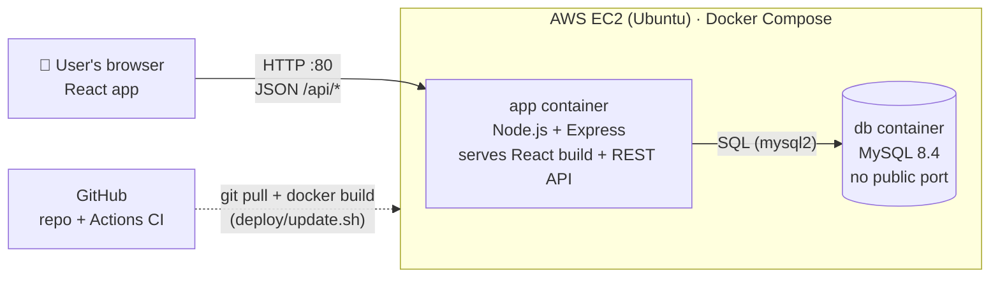
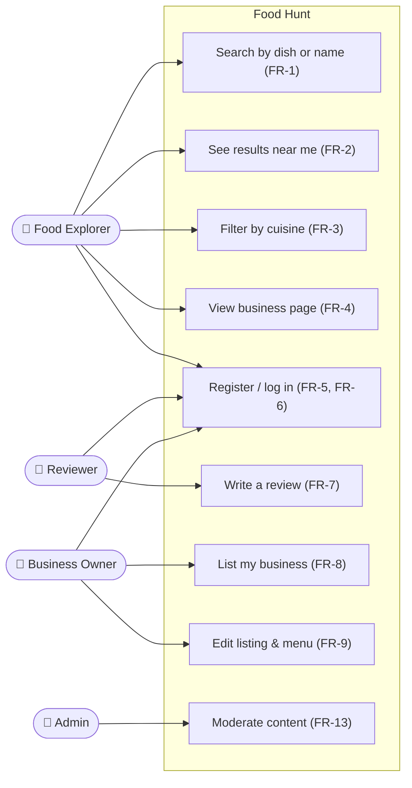
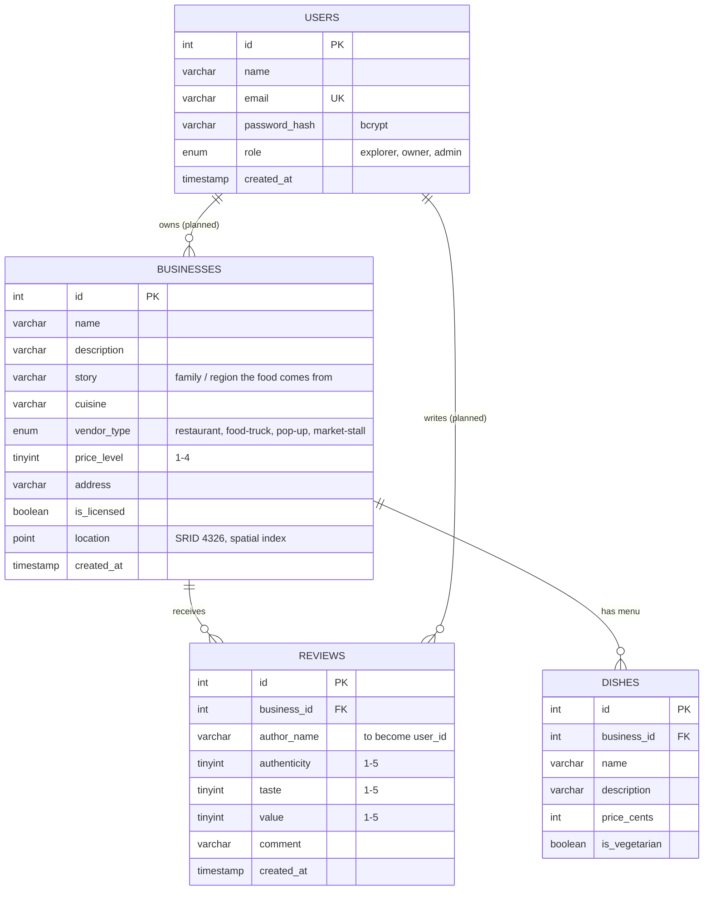
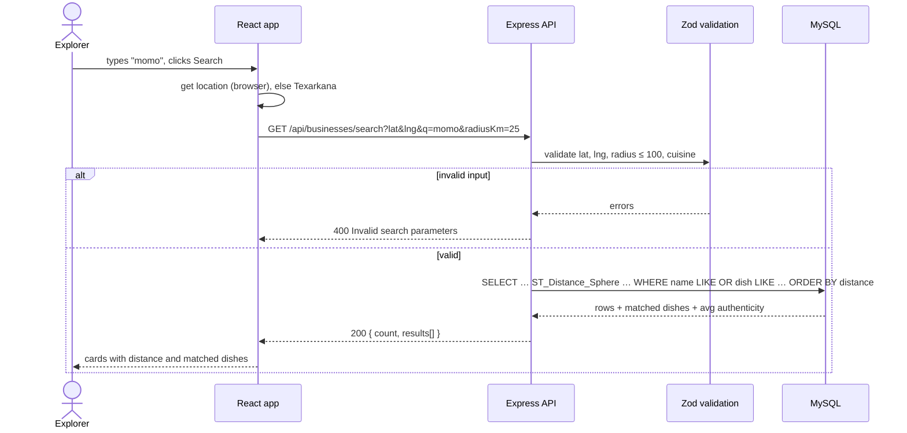
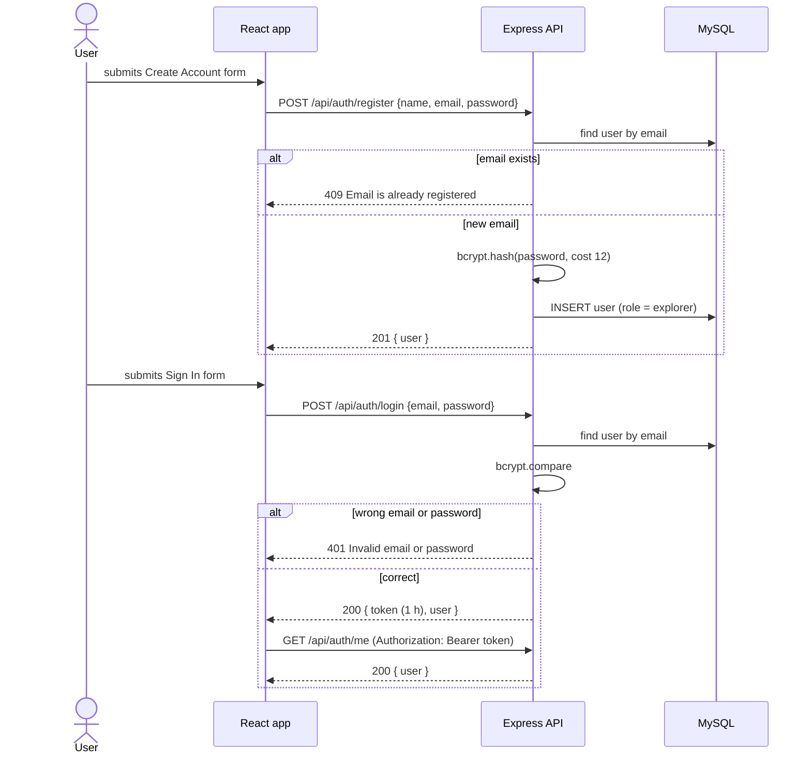
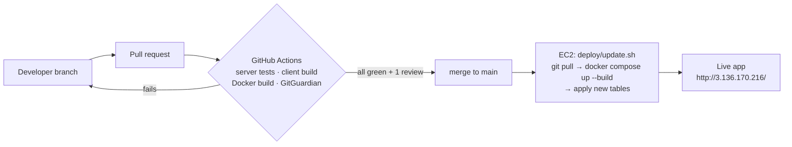

# Food Hunt – System Design

Diagrams are written in Mermaid, so GitHub renders them directly on this page
and anyone can edit them in a pull request. Requirement IDs (FR-x, NFR-x) refer
to [requirements.md](requirements.md).

## 1. Architecture overview

A single-page React app talks to an Express REST API, which stores data in
MySQL. In production, one EC2 server runs two Docker containers: the app
(API plus the built React files) and the database.



| Layer | Technology | Responsibility |
|---|---|---|
| Presentation | React 19 + Vite | Search UI, results, forms; calls the API with `fetch` |
| API | Express 4, Zod, Helmet | Routing, input validation, security headers, auth |
| Auth | bcrypt, JSON Web Tokens | Password hashing, 1-hour login tokens |
| Data access | `repository.js` (mysql2) | All SQL in one module, so routes can be unit-tested with a fake repository |
| Database | MySQL 8.4 | Businesses, dishes, reviews, users; spatial index for distance search |
| Infrastructure | Docker, AWS EC2, GitHub Actions | Reproducible builds, hosting, automated tests on every PR |

## 2. Use cases



## 3. Data model (ER diagram)



**Design decisions**
- **Location as a MySQL `POINT` with a spatial index**, so "within 25 km,
  nearest first" is one SQL query (`ST_Distance_Sphere`) instead of filtering
  in JavaScript (NFR-1).
- **Three separate ratings** (authenticity, taste, value) instead of one star
  rating, because authenticity is the product's focus (FR-7).
- **Money in cents** (`price_cents`) to avoid floating-point rounding.
- Deleting a business **cascades** to its dishes and reviews.

## 4. Key interactions

### 4.1 Dish-first search (FR-1, FR-2)



### 4.2 Register and log in (FR-5, FR-6)



## 5. Deployment and delivery pipeline



- `main` is protected: no direct pushes, one approving review, CI must pass (NFR-7).
- Secrets (`MYSQL_*`, `JWT_SECRET`) are generated on the server into `.env`
  and never committed (NFR-3).
- MySQL runs `schema.sql` only on first start; `update.sh` applies new
  `CREATE TABLE IF NOT EXISTS` tables to the existing database.

## 6. Code structure

```
server/src/
├── app.js              builds the Express app (dependency-injected repo)
├── server.js           starts the app with the real MySQL pool
├── repository.js       all SQL queries
├── validation.js       Zod schemas for every request
├── middleware/requireAuth.js   verifies Bearer tokens
└── routes/
    ├── businesses.js   search, details, create listing, reviews
    └── auth.js         register, login, me
client/src/
├── App.jsx             search page
└── api.js              all API calls in one place
```
